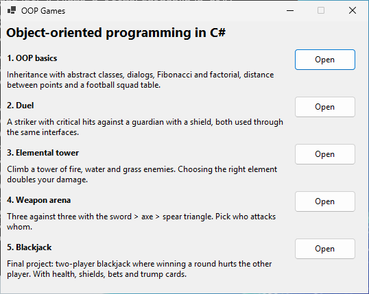
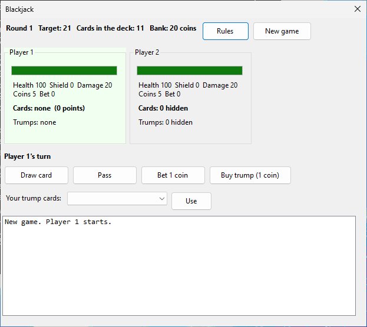
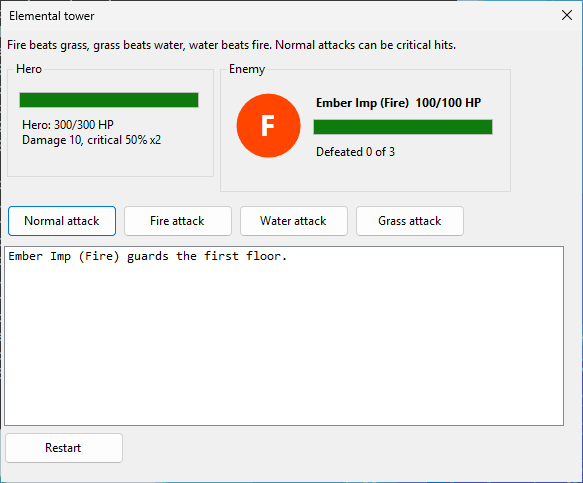
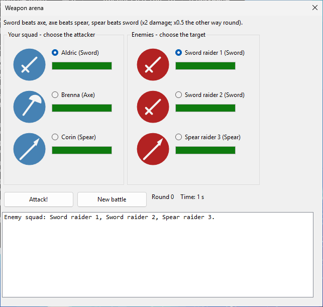
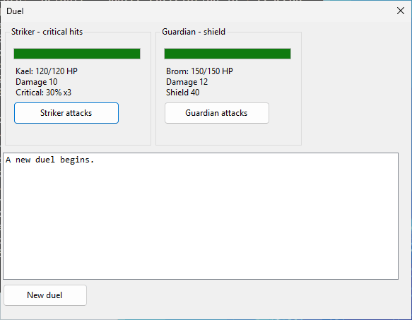

# C# WinForms Games

[](https://github.com/miguelrg14/VS_CSharp-WinForms-Games/actions/workflows/dotnet.yml)

Object-oriented programming coursework from my second year of Computer Science & Video Game Engineering at
ESNE (2020–2022), refactored into a single .NET 10 solution: a desktop launcher with five Windows Forms projects,
from inheritance basics to two-player blackjack, with every game rule kept in a separate, unit-tested library.

Part 2 of my university C# work. Part 1, console fundamentals and data structures:
[VS_CSharp-Fundamentals](https://github.com/miguelrg14/VS_CSharp-Fundamentals).

## Projects

All of them open from the launcher window, in the order they were made during the course.



| # | Project | What it shows |
| --- | --- | --- |
| 1 | **OOP basics** | Abstract classes and overriding (a character roster), message boxes and owned windows, Fibonacci and factorial with `BigInteger`, distance between two points, and a football squad table bound to a `DataGridView` |
| 2 | **Duel** | A striker with critical hits against a guardian with a shield. Both implement `IAttacker` and `IDamageable`, so one `DuelRules.Attack` method works for any pair |
| 3 | **Elemental tower** | Fight a queue of fire, water and grass enemies; the element chart doubles or halves your damage |
| 4 | **Weapon arena** | Three against three with the sword > axe > spear triangle. You choose who attacks whom; the enemy AI looks for targets it beats |
| 5 | **Blackjack** | Final project. Two players draw cards 1–11 trying to get closest to 21 without going over. The round winner hits the loser, and coins buy trump cards that add damage or shield, return a card, raise the target to 24 or 27, or take away points |

## Demos

These were recorded automatically on Windows: a [workflow](.github/workflows/demo.yml) builds the app and a
[script](.github/demo/record-demo.ps1) plays each game through UI Automation, taking a screenshot after every click.

### Blackjack

Two players take turns drawing cards and betting; the screen hides each hand while the players change seats.
Two passes in a row end the round, and the winner hits the loser.



### Elemental tower

Choosing the element that beats each enemy (fire > grass > water > fire) doubles the damage.



| Weapon arena | Duel |
| --- | --- |
|  |  |

## Structure

```
src/OopGames.Core             Game rules only (net10.0, no UI): characters, combat, battles, blackjack
src/OopGames.Desktop          Windows Forms app (net10.0-windows): launcher and one form per project
tests/OopGames.Core.Tests     xUnit tests for every rule in OopGames.Core
tests/OopGames.Desktop.Tests  Smoke tests that build and lay out every window
```

The forms do not contain game logic: they call methods such as `TowerBattle.Attack` or `BlackjackGame.Draw`
and redraw the state. Because the rules live in a plain class library, they are tested on every push, even
though the windows themselves only run on Windows.

The forms are built in code (no designer files), so each screen can be read top to bottom in one file.
The unit sprites are drawn at runtime with GDI+, so the project contains no third-party art or audio.

## Download

A ready-to-run build is on the [Releases page](https://github.com/miguelrg14/VS_CSharp-WinForms-Games/releases/latest):
download `OopGames-win-x64.zip`, extract it and run `OopGames.Desktop.exe`. Windows only; no .NET installation is needed.

## Getting started

Requires Windows and the [.NET 10 SDK](https://dotnet.microsoft.com/download).

```bash
git clone https://github.com/miguelrg14/VS_CSharp-WinForms-Games.git
cd VS_CSharp-WinForms-Games

dotnet run --project src/OopGames.Desktop   # opens the launcher
dotnet test                                  # runs the rule tests
```

Or open `OopGames.sln` in Visual Studio and run `OopGames.Desktop`.

## Continuous integration

- Every push and pull request builds the solution on Windows and runs all the tests.
- The [demo workflow](.github/workflows/demo.yml), started by hand from the Actions tab, records the demos above again
  and pushes the screenshots to the `demo-frames` branch.
- Pushing a version tag (`git tag v1.0.0 && git push origin v1.0.0`) publishes a self-contained, single-file
  `.exe` to Releases.

## Design notes

- **Inheritance where it models a real "is a" relationship**: `Goalkeeper` and `OutfieldPlayer` both derive from
  `SquadMember`, and `Striker` and `Guardian` from `Fighter`. Subclasses override only what makes them different.
- **Interfaces for behaviour**: anything that is an `IAttacker` can hit anything that is an `IDamageable`.
- **Testable randomness**: every class that rolls dice receives a `Random`, so tests can pass a seeded or fixed one.
- **No impossible states**: a card is removed from the deck when it is drawn, so it can never be dealt twice;
  health never drops below zero; points are computed from the hand instead of being stored separately.

## License

[MIT](LICENSE)
